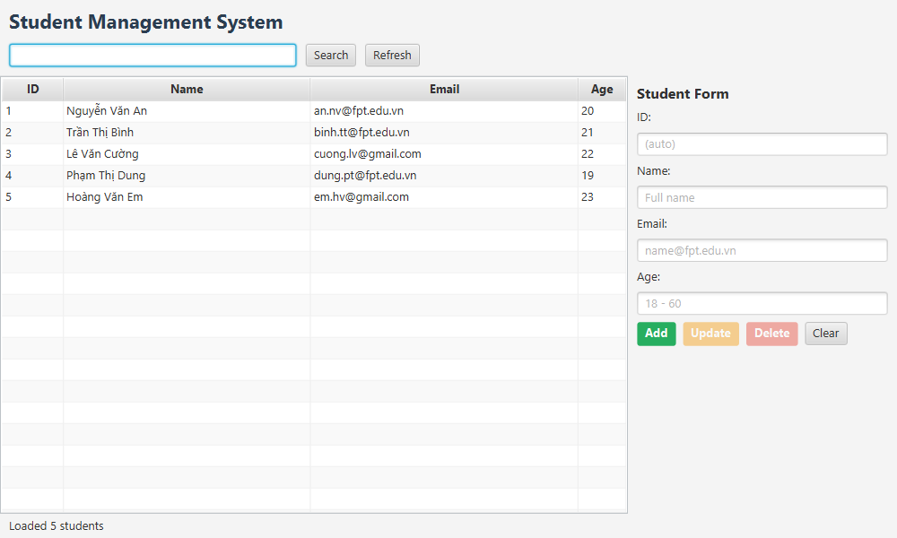
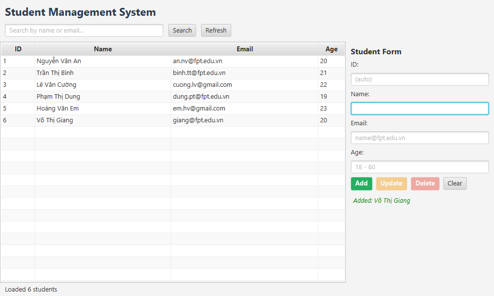
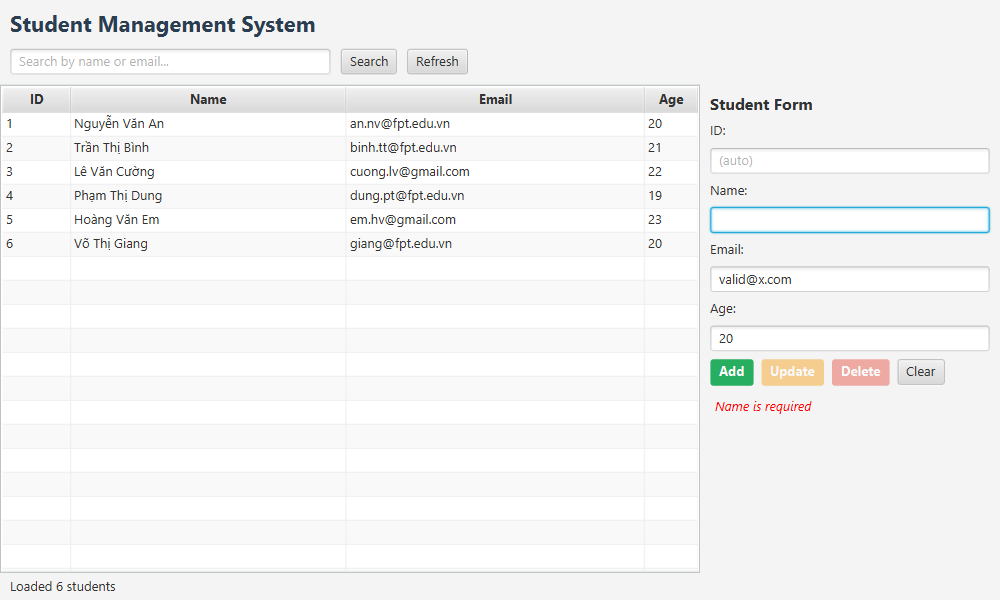
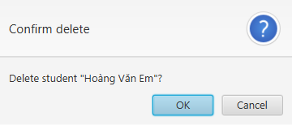

# Student Management System (JavaFX + Spring Data JPA)

Ứng dụng quản lý sinh viên theo `Chapter09_solution.md`, hoàn thành TODO #1–#7.

## Môi trường

- JDK 21, Maven 3.9+.
- Spring Boot 4.1.1, JavaFX 21.0.5, Hibernate/Jakarta Persistence do Spring Boot quản lý.
- SQL Server bật TCP/IP, mặc định `localhost:1433`.
- IntelliJ IDEA; Gluon Scene Builder nếu cần sửa FXML.

## Cấu hình và chạy

Chạy SQL sau trong SQL Server Management Studio:

```sql
IF DB_ID('StudentDB') IS NULL CREATE DATABASE StudentDB;
```

Cấu hình tại `ui-module/src/main/resources/application.properties`. Các giá trị kết nối nhận từ biến môi trường; mật khẩu không được lưu trong Git. Ví dụ trong PowerShell:

```powershell
$env:DB_USERNAME = 'sa'
$env:DB_PASSWORD = '<mat-khau-SQL-Server>'
# Chỉ đặt DB_URL khi dùng server/port/database khác mặc định:
# $env:DB_URL = 'jdbc:sqlserver://localhost:1433;databaseName=StudentDB;encrypt=false;trustServerCertificate=true'
mvn clean install
mvn -f ui-module/pom.xml spring-boot:run
```

Hoặc chạy class `fu.de200388.ui.Launcher` trong IntelliJ với cùng biến môi trường.
Hibernate tạo/cập nhật bảng `students` khi khởi động. Ở lần đầu danh sách trống;
để chạy các kịch bản mẫu, mở app một lần cho Hibernate tạo bảng, rồi chạy
[docs/seed.sql](docs/seed.sql) trong SSMS và nhấn **Refresh**.

## Build và test

```powershell
mvn -q clean install
```

Test dùng H2 in-memory, không yêu cầu SQL Server hoặc mật khẩu:

- `StudentRepositoryTest`: 10 lượt chạy.
- `StudentServiceImplTest`: 16 lượt chạy (12 method, có parameterized test).

Kiểm tra giao diện JavaFX thật với Spring và H2, chụp lại bốn ảnh minh họa:

```powershell
powershell -NoProfile -ExecutionPolicy Bypass -File docs/qa/run-ui-check.ps1
```

Lệnh này cần desktop Windows và JDK 21; tự build, chạy các thao tác kiểm tra,
đóng context, rồi kết thúc tiến trình. Nếu cache Maven mặc định không ghi được,
dùng `-RepositoryPath '<duong-dan-cache-ghi-duoc>'`. Bộ kiểm tra dùng database H2
riêng, không sửa dữ liệu SQL Server. Xem [kết quả và giới hạn kiểm tra](docs/verification.md).

## Kiến trúc

```text
StudentController → StudentService → StudentServiceImpl → StudentRepository → SQL Server
```

| Module | Thành phần |
|---|---|
| `data-module` | Student entity, JpaRepository, exceptions, Service/ServiceImpl, test H2 |
| `ui-module` | Spring Boot bootstrap, JavaFX Application/Launcher, controller, FXML, CSS, cấu hình DB |

Package gốc là `fu.de200388` để Spring quét cả entity, repository, service và controller.
FXMLLoader lấy controller từ Spring bằng `setControllerFactory(context::getBean)`.
Các thao tác ghi có transaction; chuẩn hóa và kiểm tra nghiệp vụ nằm trong service.
Update tạo bản chỉnh sửa riêng, giữ dữ liệu bảng khi validation thất bại. Delete
cần xác nhận. Update/Delete chỉ bật khi có sinh viên được chọn.

## Ảnh chụp

Ảnh từ giao diện JavaFX thật, dùng H2 và năm sinh viên mẫu trong đề.





